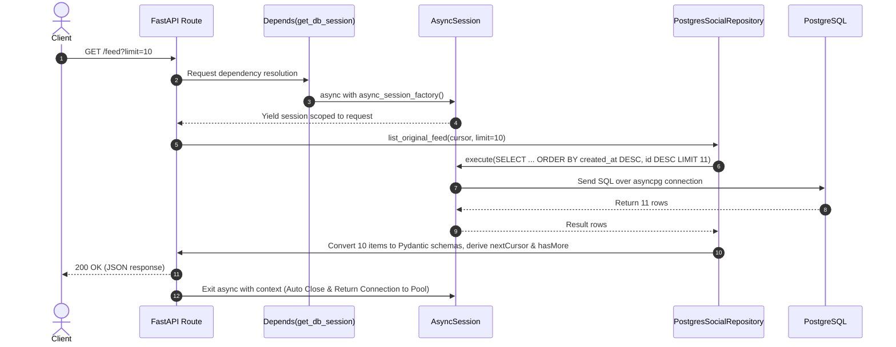
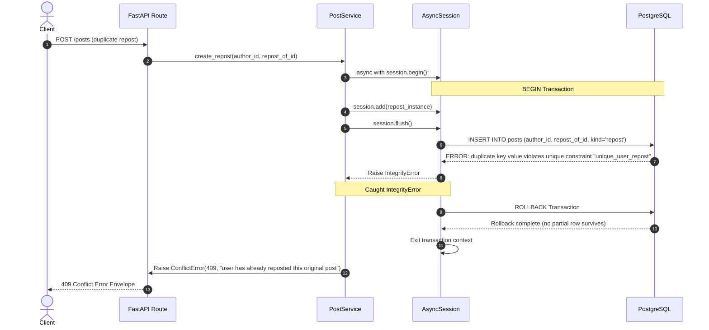

# Async Session Boundaries — FastAPI & SQLAlchemy 2.0

This document explains the lifecycle of SQLAlchemy's `AsyncSession` across requests, the transaction boundaries during failures, and how the social feed remains bounded.

---

## 1. Why `len(post)` is not a license to load all comments

In the earlier Topic 12 OOP exercise, Python objects could implement `__len__` or store a list of comments directly:
```python
class Post:
    def __init__(self, comments=None):
        self.comments = comments or []
    def __len__(self):
        return len(self.comments)
```
In a relational database, accessing comments or reactions by loading the entire list into memory would turn a simple count into an `O(N)` memory and network disaster. 

- **At the database boundary**: Like counts and reply counts are computed using SQL aggregation:
  ```sql
  SELECT COUNT(*) FROM posts WHERE reply_to_id = :post_id;
  ```
- **At the repository boundary**: Repositories return bounded scalars (`get_reply_count`, `get_like_count`) or grouped aggregate batches across a page of IDs. No rows of comments or likes are transferred just to count them.
- **Bounding the feed**: The feed query selects only `limit + 1` rows using a strict tuple filter `(created_at, id) < (:created_at, :id)`. The extra record determines `hasMore` and `nextCursor`.

---

## 2. Request Timeline: Successful GET /feed



---

## 3. Failed Transaction Timeline: Integrity Violation & Rollback

When creating a reply or repost that violates relational invariants or duplicates an existing repost:



---

## Key Rules Followed:
1. **Never share sessions across concurrent tasks**: Each HTTP request receives its own session via FastAPI dependency injection.
2. **Commit / Rollback at the Service boundary**: Repositories execute queries; transactions are managed explicitly around discrete business actions.
3. **expire_on_commit=False**: Attributes accessed after commit do not trigger unexpected lazy loads after the session is closed.
