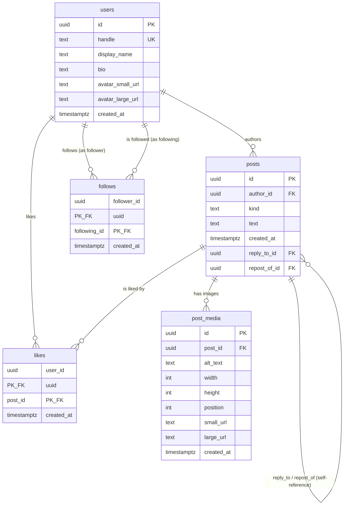

# Entity Relationship Diagram — Social Feed

## Entities

- **users** — one row per person
- **posts** — one row per original, reply, OR repost (a single table with a
  `kind` discriminator column, not three separate tables — see
  `decisions.md` for why)
- **post_media** — images attached to an original post
- **likes** — association between a user and a post they liked
- **follows** — directional association between two users

## Diagram

## Relationships explained

**user → authored posts: one-to-many.**
One user can author any number of posts (originals, replies, or
reposts); each post has exactly one author. Enforced by `posts.author_id`
being a required foreign key to `users.id`.

**original → direct replies and repost references: one-to-many (self-referencing).**
`posts.reply_to_id` and `posts.repost_of_id` both point back to
`posts.id`. One original can have many replies and many reposts
pointing at it; a reply/repost points at exactly one original. Both
columns live on the same table because a post is never both a reply
and a repost at once — see the `kind` discriminator discussion below.

**original → ordered images: zero-to-many, capped at four.**
`post_media.post_id` is a required foreign key to `posts.id`. The
"capped at four" and "only on originals" rules are **not** something a
foreign key alone can express — a foreign key only guarantees the post
exists, not how many siblings it has or what kind of post it is. That
enforcement is documented explicitly in `decisions.md` (Deliverable 2).

**users ↔ posts through likes: many-to-many.**
One user can like many posts; one post can be liked by many users. The
`likes` table is the join table making that many-to-many relationship
possible — without it, you'd need a repeating/comma-separated list of
likes on each post, which breaks normalization (see the 1NF/2NF/3NF
discussion in `decisions.md`).

**users ↔ users through directional follows: many-to-many, self-referencing, directional.**
`follows.follower_id` and `follows.following_id` both point to
`users.id`. "Directional" matters here: A following B is a completely
separate fact from B following A — the table doesn't assume symmetry,
which is why both columns are needed rather than one "friendship" row.
